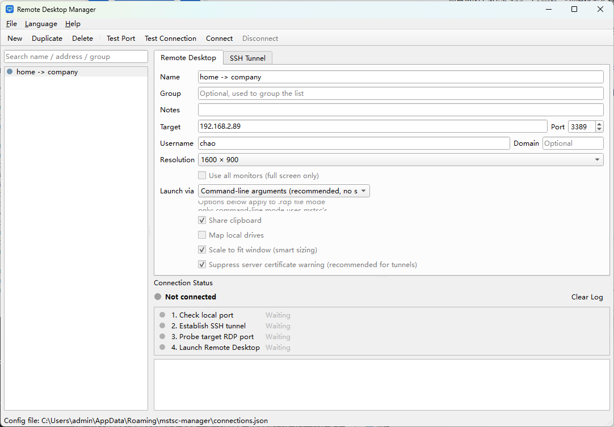
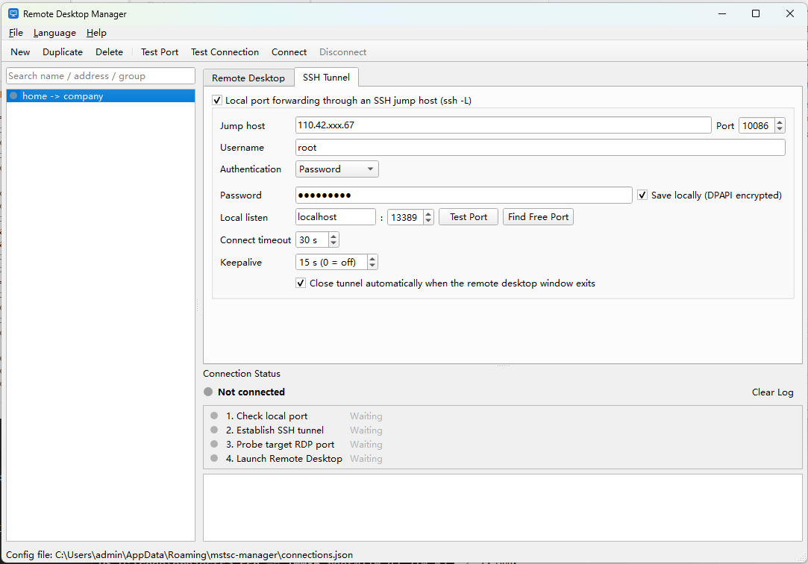

# Remote Desktop Manager (mstsc-manager)

**English** | [中文](README_zh.md)

A small Windows tool that keeps your Remote Desktop (`mstsc`) connections in one list and launches them with one click —
optionally **through an SSH jump host**. For each connection you can pick a resolution preset, and when a tunnel is
configured the app checks the local port, logs in to the jump host, probes the target's RDP port, and only then starts
`mstsc`, showing the result of every step. Menus switch between English and Chinese at runtime.

| Remote Desktop settings | SSH tunnel settings |
|---|---|
|  |  |

## Features

- **Connection list** with search and grouping; a colored dot shows each connection's state (idle / connecting / running / error). Double-click to connect.
- **Resolution presets**: 1280×720 · 1366×768 · 1600×900 · 1920×1080 · 2560×1440 · 3840×2160 · full screen (optionally all monitors) · custom.
- **SSH tunnel per connection** (`ssh -L` style local port forwarding): jump host, password or private-key auth, fixed or auto-assigned local port, keepalive, connect timeout.
- **Pre-flight checks**: *Test Port* tells you whether the local port is free; *Test Connection* logs in to the jump host and probes the target's port 3389 (with latency) without opening a desktop.
- **Step-by-step status** — check local port → establish SSH tunnel → probe target RDP port → launch Remote Desktop — plus a per-connection log.
- **Tunnel lifecycle**: the tunnel closes automatically when the `mstsc` window exits (configurable); a dropped SSH session is flagged in red.
- **Two launch modes**: command-line arguments (default; no security prompt on current Windows) or a generated `.rdp` file (more options).
- **Import / export** the connection list as JSON; **English / Chinese** UI.
- **Help menu**: version history and *Check for Updates* against GitHub Releases, with a one-click download link.

## Download

Grab the latest `mstsc-manager-vX.Y.Z-windows-x64.zip` from [Releases](../../releases), unzip anywhere and run
`mstsc-manager.exe`. No installation required; the `SHA256SUMS.txt` next to it lets you verify the download.

Requirements: Windows 10/11 x64 with the built-in Remote Desktop client (`mstsc.exe`). Nothing else to install.

## Run from source

Needs [uv](https://docs.astral.sh/uv/) (it will fetch Python 3.12 itself):

```powershell
git clone https://github.com/ccbs-tools/mstsc-manager.git
cd mstsc-manager
uv sync
uv run python main.py        # or double-click run.cmd
```

## Usage

1. **New** creates a connection. On the *Remote Desktop* tab fill in the target address, port, username and pick a resolution.
   Changes are saved automatically.
2. If the target is only reachable through a bastion, open the *SSH Tunnel* tab, tick the group box and enter the jump host,
   username and either a password or a private key. Leave the password empty to be asked each time, or tick *Save locally*
   (encrypted with Windows DPAPI, readable only by your Windows account on this machine).
3. **Test Port** checks the chosen local port (or shows a free one in auto mode). **Test Connection** runs the first three
   steps and disconnects — useful to verify credentials and reachability.
4. **Connect** (or double-click / `F5`) runs all four steps and opens Remote Desktop pointing at `127.0.0.1:<local port>`.
   Enter your Windows password in the `mstsc` prompt as usual.
5. **Disconnect** (`F7`) closes the tunnel (and the desktop window if still open).

Keyboard: `Ctrl+N` new · `Ctrl+D` duplicate · `Del` delete · `F5` connect · `F6` test · `F7` disconnect.

### Notes

- Since the April 2026 Windows update, opening a `.rdp` **file** always shows a security dialog and ignores redirection
  settings. The app therefore launches `mstsc` with command-line arguments by default. Clipboard / drive redirection in that
  mode follow mstsc's own defaults (`Documents\Default.rdp`), which you can change once in mstsc's *Options*. Switch
  *Launch via* to `.rdp file` if you need per-connection control and don't mind the prompt.
- The RDP password is never stored; only the username is pre-filled.
- A probe time of several seconds means the **jump host → target** leg is slow; the desktop session will feel the same.

### Files

| What | Where |
|---|---|
| Connections | `%APPDATA%\ccbs\mstsc-manager\connections.json` (previous version kept as `.bak`) |
| Jump-host keys | `%APPDATA%\ccbs\mstsc-manager\known_hosts` |
| Logs | `%APPDATA%\ccbs\mstsc-manager\logs\app.log` (*Help → Open Log Folder*) |

## Package (onedir)

```powershell
build.cmd
# → dist\mstsc-manager\mstsc-manager.exe plus mstsc-manager-vX.Y.Z-windows-x64.zip
```

Pushing a `v*` tag builds the same zip on GitHub Actions and publishes it to this repository's Releases.
See [dev.md](dev.md) for the release checklist and code layout.

## Built with

[PySide6](https://doc.qt.io/qtforpython/) · [paramiko](https://www.paramiko.org/) · [loguru](https://github.com/Delgan/loguru) · [PyInstaller](https://pyinstaller.org/)
