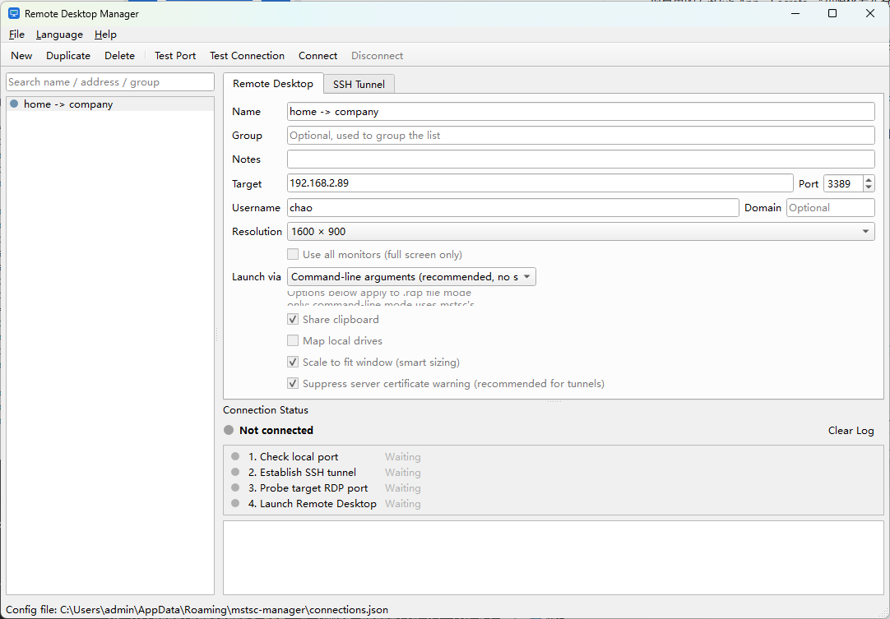
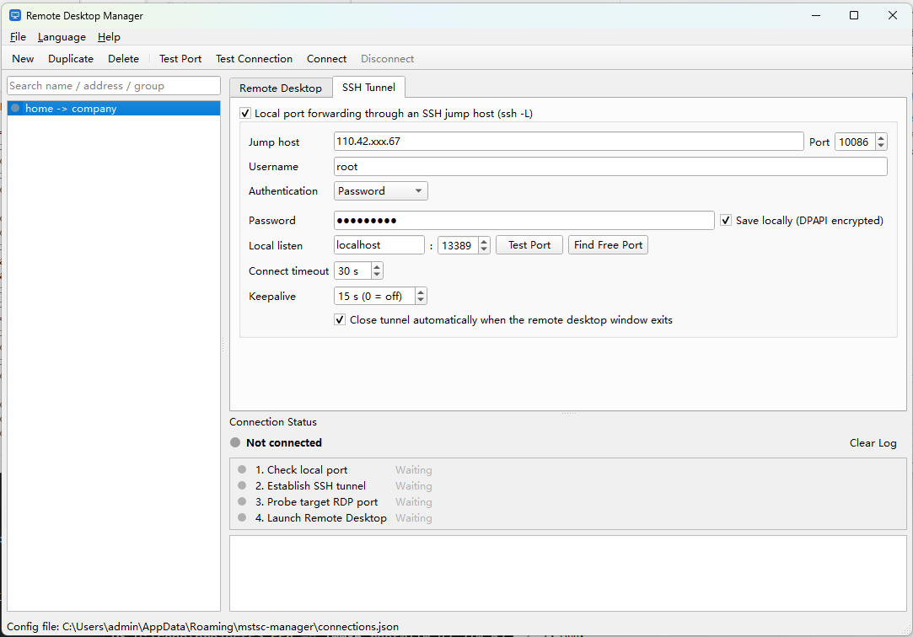

# 远程桌面管理器（mstsc-manager）

[English](README.md) | **中文**

一个小巧的 Windows 工具，把常用的远程桌面（`mstsc`）连接集中管理、一键打开，并且可以**经 SSH 跳板机**连接。
每条连接可选分辨率档位；配置了隧道的连接会先检查本地端口、登录跳板机、探测目标的 RDP 端口，确认都通了才启动
`mstsc`，每一步的结果都直接显示出来。菜单栏支持中英文实时切换。

| 远程桌面设置 | SSH 隧道设置 |
|---|---|
|  |  |

## 功能

- **连接列表**：支持搜索和分组，每条前面的圆点表示状态（未连接 / 连接中 / 运行中 / 错误），双击即连接。
- **分辨率档位**：1280×720 · 1366×768 · 1600×900 · 1920×1080 · 2560×1440 · 3840×2160 · 全屏（可选所有显示器）· 自定义。
- **每条连接独立的 SSH 隧道**（`ssh -L` 本地端口转发）：跳板机地址、密码或私钥认证、固定或自动分配的本地端口、保活、连接超时。
- **连接前检查**：「测试端口」告诉你本地端口是否被占用；「测试连接」登录跳板机并探测目标 3389 端口（显示耗时），不打开桌面。
- **分步状态**：检查本地端口 → 建立 SSH 隧道 → 探测目标 RDP 端口 → 启动远程桌面，外加每条连接独立的日志。
- **隧道生命周期**：`mstsc` 窗口关闭后自动断开隧道（可关闭）；SSH 中途断线会标红提示。
- **两种启动方式**：命令行参数（默认，新版 Windows 下无安全确认框）或生成 `.rdp` 文件（可控项更多）。
- **导入 / 导出**连接列表（JSON）；**中 / 英**双语界面。
- **帮助菜单**：版本介绍，以及对照 GitHub Releases 的「检查更新」，有新版本可一键打开下载。

## 下载

到 [Releases](../../releases) 下载最新的 `mstsc-manager-vX.Y.Z-windows-x64.zip`，解压到任意位置运行 `mstsc-manager.exe` 即可，
无需安装；旁边的 `SHA256SUMS.txt` 可用来校验下载。

运行要求：Windows 10/11 x64，自带的远程桌面客户端（`mstsc.exe`）。不需要安装其他东西。

## 从源码运行

需要 [uv](https://docs.astral.sh/uv/)（它会自动下载 Python 3.12）：

```powershell
git clone https://github.com/ccbs-tools/mstsc-manager.git
cd mstsc-manager
uv sync
uv run python -m mstsc_manager   # 或双击 run.cmd
```

## 使用

1. 点「新建」创建连接，在「远程桌面」页填目标地址、端口、用户名，选分辨率。所有修改自动保存。
2. 如果目标只能通过跳板机访问，切到「SSH 隧道」页勾选启用，填跳板机地址、用户名，选密码或私钥。
   密码留空则每次连接时询问；勾选「保存到本地」会用 Windows DPAPI 加密保存，只有本机当前 Windows 账户能解开。
3. 「测试端口」检查所选本地端口是否空闲（自动模式下显示一个可用端口）；「测试连接」只跑前三步然后断开，
   用来验证账号和网络是否通。
4. 「连接」（或双击 / `F5`）跑完四步后打开远程桌面，地址为 `127.0.0.1:<本地端口>`，在 `mstsc` 的登录框里照常输入 Windows 密码。
5. 「断开」（`F7`）关闭隧道（桌面窗口若还开着也会一起关掉）。

快捷键：`Ctrl+N` 新建 · `Ctrl+D` 复制 · `Del` 删除 · `F5` 连接 · `F6` 测试 · `F7` 断开。

### 说明

- 2026 年 4 月的 Windows 更新之后，用 `.rdp` **文件**打开远程桌面每次都会弹安全确认框，且文件里的重定向设置会被忽略。
  因此本程序默认用命令行参数启动 `mstsc`。这种方式下剪贴板 / 驱动器映射等沿用 mstsc 自身的默认设置
  （`文档\Default.rdp`），在 mstsc 的「选项」里改一次即长期生效。需要按连接单独控制且不介意确认框的，可把「启动方式」
  切到 `.rdp 文件`。
- 远程桌面的密码不会被保存，只预填用户名。
- 探测耗时达到数秒，说明**跳板机 → 目标**这一段网络慢，桌面会话也会同样卡。

### 文件位置

| 内容 | 位置 |
|---|---|
| 连接配置 | `%APPDATA%\ccbs\mstsc-manager\connections.json`（上一版保留为 `.bak`） |
| 跳板机主机密钥 | `%APPDATA%\ccbs\mstsc-manager\known_hosts` |
| 日志 | `%APPDATA%\ccbs\mstsc-manager\logs\app.log`（菜单「帮助 → 打开日志目录」） |

## 打包（onedir）

```powershell
build.cmd
# → dist\mstsc-manager\mstsc-manager.exe，以及 mstsc-manager-vX.Y.Z-windows-x64.zip
```

推送 `v*` tag 后 GitHub Actions 会打出同样的 zip 并发布到本仓库的 Releases。发版步骤和代码结构见 [dev.md](dev.md)。

## 基于

[PySide6](https://doc.qt.io/qtforpython/) · [paramiko](https://www.paramiko.org/) · [loguru](https://github.com/Delgan/loguru) · [PyInstaller](https://pyinstaller.org/)
